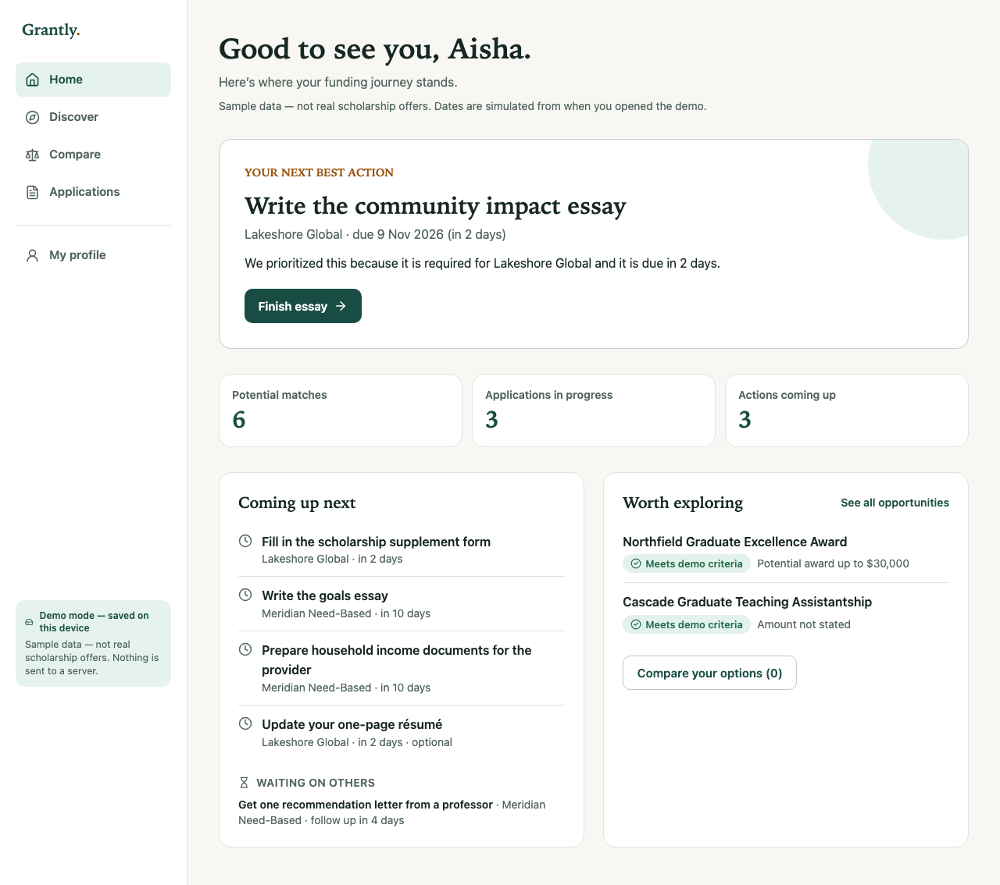

# GRANTLY

**Find your funding. Know your fit. Make your move.**

GRANTLY helps a final-year Indian undergraduate (or recent graduate) planning a US master's degree find scholarships, understand whether they qualify and why, compare what each option *actually* leaves them to pay, and keep every application on track.

> **Demo data:** every scholarship, provider, university and program in this build is **fictional**. Nothing here is a real scholarship offer. The sample student "Aisha" is fictional and editable.

- Live app: https://grantly-snowy.vercel.app
- Source: https://github.com/Hasmitha0498/grantly
- Persistence: **Demo mode, saved on this device** (versioned `localStorage`). No account and no server.

## Documentation

[Architecture](docs/ARCHITECTURE.md) · [Product flows](docs/PRODUCT_FLOWS.md) · [Testing](docs/TESTING.md) · [Performance](docs/PERFORMANCE.md) · [Accessibility](docs/ACCESSIBILITY.md) · [Decisions](docs/DECISIONS.md)



## The problem

Funding information is scattered. Eligibility gets confused with competitiveness. Headline award amounts hide the real cost of a program. Deadlines, essays and recommender follow-ups live in different places. GRANTLY connects these into one flow: **profile → fit → decision → application → next action**.

## Experience flow (P0)

| Route | What it does |
|---|---|
| `/` | Welcome, with **Explore a demo journey**, **Create my funding profile** and **Continue my journey** |
| `/onboarding` | Three-step profile with validation, focus on the first error and back without losing data |
| `/dashboard` | **Your next best action** with the reason it was prioritized, journey metrics, coming-up list, waiting-on-others and recommendations |
| `/discover` | Text search, filters (funding type, eligibility, course, deadline), sorting, URL-synced state, save and compare (max 3, program-aware) |
| `/scholarships/[id]` | **Funding Fit**: line-by-line eligibility, evidence alignment, per-program cost coverage, application route and source transparency |
| `/compare` | **Decision Studio**: full-program cost, potential vs confirmed funding, budget gap, priority-driven "why" and "what you're trading off" |
| `/applications` | Status tabs, progress on required steps only, next action per application |
| `/applications/[id]` | Checklist (To do / Waiting on someone / Ready), follow-up dates, explicit self-reported submission, award and offer response |
| `/applications/[id]/essay/[promptId]` | **Essay Studio**: prompt interpretation, Story Bank, outline, draft with word count, debounced autosave and revision conflict handling |
| `/profile` | Edit everything, add structured evidence, reset the demo |

## Signature engines (pure, tested: `src/domain`)

- **Eligibility** (`eligibility.ts`) is a mandatory-rule gate that returns `eligible`, `not-eligible`, `needs-information` or `unverified`. It never gives a percentage. It never converts between grading scales or currencies, and never infers residency from nationality. Missing household income produces "needs information", never a pass. `income-max` uses `<=`.
- **Evidence** (`evidence.ts`) compares documented selection criteria with the student's own structured evidence. It is not a probability.
- **Financial** (`financial.ts`) computes the full-program horizon. The award is capped at the cost categories it explicitly covers. Periodic awards are multiplied only by documented periods. Unknown data produces "Insufficient data" (never NaN). Potential and confirmed funding are separate scenarios, and non-stackable awards are never summed.
- **Decision** (`decision.ts`) compares explicit `(scholarshipId, programId)` options. Ineligible options are never recommended. Ties and missing data produce an explicit inconclusive result.
- **Action Engine** (`action-priority.ts`) produces a deterministic tiered priority list. Tasks inherit the application deadline. Follow-ups surface only when `nextFollowUpOn` arrives. Waiting-on-others items are listed separately. Award responses clear once recorded.
- **Application state** (`application-state.ts`) validates transitions. "Ready to submit" is **derived**, never stored.
- **Essay** (`essay.ts`) does deterministic word counting. "Ready" requires a non-empty draft within the limit plus explicit student confirmation.

## Stack

Next.js 16 (App Router) · React 19 · TypeScript strict · Tailwind CSS 4 · Radix Dialog · Lucide · Zod · Vitest + Testing Library · Playwright + axe-core.

Server components render static shells and the catalog; scholarship detail pages are statically generated. Small client components handle interaction. The Essay Studio is code-split.

## Architecture

```
src/app            routes, loading/error/not-found, /api/health
src/components     shell, ui, onboarding, discover, funding, compare, apply, essay, dashboard
src/domain         types, Zod schemas, pure business rules (no React)
src/data           versioned fictional catalog + demo persona
src/repository     journey-core.ts (pure state transitions, idempotent start, CAS essay save)
                   local-store.ts (versioned localStorage adapter, schema-validated, storage-event sync)
                   use-journey-actions.ts (mutation facade: persist first, then report success)
supabase/migrations/001_initial.sql   cloud schema + RLS (reference only, not active)
```

## Persistence modes and honesty

This build runs **only** in on-device demo mode. The UI says "Demo mode — saved on this device" everywhere, and no cloud claims are made. A save reports success only after the write succeeds. A failed write shows "Your changes couldn't be saved." with **Retry**. Corrupt or incompatible stored data is detected by Zod and reset safely.

**Cloud mode (not enabled):** `supabase/migrations/001_initial.sql` defines owner-only RLS on every table, composite `(application_id, user_id)` foreign keys, unique `(user, scholarship, program)` applications, and a compare-and-swap essay save. It has **not** been applied or verified against a live Supabase project, and no API data routes ship in this build. To enable it you would need to: create a Supabase project, enable anonymous sign-ins, apply the migration, set `NEXT_PUBLIC_SUPABASE_URL` and `NEXT_PUBLIC_SUPABASE_PUBLISHABLE_KEY`, implement the route handlers against `journey-core`, and run the two-session isolation test. Never commit a service-role key.

## Setup

```bash
npm ci
npm run dev
```

No environment variables are required. `.env.example` lists the optional cloud variables.

## Scripts

| Command | Covers |
|---|---|
| `npm run typecheck` | `tsc --noEmit` (strict) |
| `npm run lint` | ESLint, zero warnings allowed |
| `npm run test:run` | 225 Vitest tests: domain engines, repository, storage, and component interaction tests |
| `npm run test:coverage` | Same tests with v8 coverage and enforced domain thresholds |
| `npm run build` | Production build |
| `npm run test:e2e` | 17 Playwright tests (set `E2E_BASE_URL` to test a deployment) on the production build: full demo journey, profile→fit recompute, search/filter/bookmark, compare/priority/budget, idempotent start + submission, deep links/back/forward, onboarding validation + focus, follow-up timing, inert HTML injection, no overflow at 320/375/768/1024/1440px, axe on 10 routes |
| `npm run test:a11y` | Only the axe test |

## Verified results (7 Nov 2026, 17:50 IST)

| Check | Result |
|---|---|
| `npm ci` → `typecheck` → `lint` (0 warnings) → `build` | Pass |
| `npm run test:coverage` | 225/225 pass (23 files: 131 domain/repository unit + 94 component interaction) |
| Coverage, all instrumented `src/` (route wrappers included) | 89.9% statements · 85.1% branches · 84.9% functions · 92.2% lines |
| Coverage, `src/domain` | 96.7% statements · 92.4% branches · 97.8% functions · 98.9% lines (thresholds enforced) |
| Coverage, `src/repository` | 96.2% statements · 96.8% branches · 93.4% functions · 96.6% lines |
| `npm run test:e2e`, local production build and live URL | 17/17 pass (including axe on 10 routes, keyboard and focus restore, overflow at 320–1440px, corrupted storage) |
| `npm audit --omit=dev` | 0 vulnerabilities |

Lighthouse 12, default mobile emulation, one lab run per page against production from a local machine. The browser was fresh, so personalised routes show their "set up your journey" state.

| Page | Perf | A11y | Best practices | FCP | LCP | CLS | TBT |
|---|---|---|---|---|---|---|---|
| `/` | 99 | 100 | 100 | 0.9 s | 2.0 s | 0 | 40 ms |
| `/dashboard` | 99 | 100 | 100 | 0.8 s | 2.0 s | 0 | 40 ms |
| `/discover` | 99 | 100 | 100 | 0.8 s | 2.0 s | 0 | 0 ms |
| `/compare` | 100 | 100 | 100 | 0.8 s | 1.8 s | 0 | 20 ms |
| `/applications` | 100 | 100 | 100 | 0.8 s | 1.8 s | 0 | 50 ms |
| `/applications/[id]` | 99 | 100 | 100 | 0.8 s | 2.0 s | 0 | 80 ms |
| Essay Studio | 99 | 100 | 100 | 0.8 s | 2.0 s | 0 | 70 ms |

INP is a field metric and was not measured. A CI workflow (`.github/workflows/ci.yml`) is prepared, but pushing it requires a GitHub token with the `workflow` scope.

## Accessibility and security

- One `h1` per route and landmarks (`header`, `nav`, `main`). There is a skip link, and `aria-current` marks the active page.
- Every input has a persistent label and helper/error text wired through `aria-describedby`. `aria-invalid` is set, and focus moves to the first error.
- Radix dialogs trap focus, close on Escape and restore focus. Live regions announce saves and results. Status is never shown by colour alone.
- Visible focus ring. Reduced motion is respected.
- User text is rendered only as React text: no `dangerouslySetInnerHTML`. Outbound links go through `safeExternalUrl` (https only) and use `rel="noopener noreferrer"`.
- All persisted state is validated with Zod and bounded.
- Security headers: `nosniff`, `Referrer-Policy`, `X-Frame-Options: DENY`, `Permissions-Policy`, HSTS.

## Known limitations

- Fictional catalog only: no verified live scholarships, no provider integrations, no status sync and no award prediction. Awards and submissions are recorded by the student.
- Data lives in one browser. Clearing site data erases it, and there is no cross-device sync.
- "Today" is the UTC calendar date. Deadlines are provider dates with no invented closing time.
- Cloud mode (Supabase) is designed but not implemented or verified in this build.
